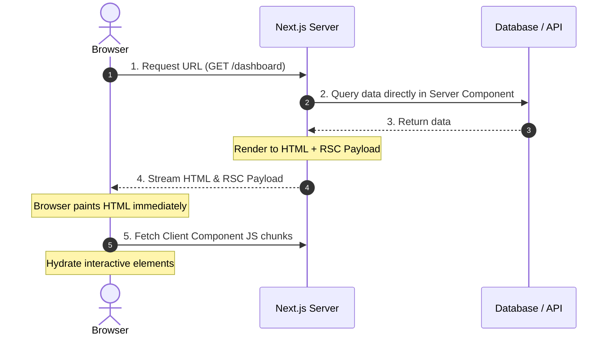
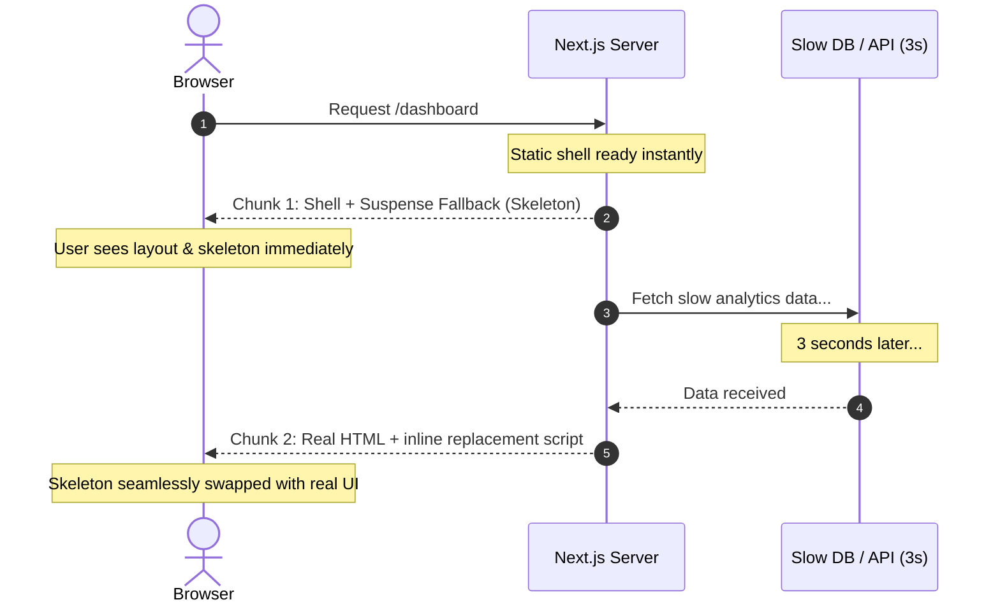

# Next.js App Router Learning Project

A hands-on Next.js project exploring the modern **App Router** architecture, nested routes, dynamic segments, and the core rendering lifecycle.

---

## 🛠 Tech Stack

- **Framework:** Next.js 16 (App Router)
- **Library:** React 19 / React DOM 19
- **Styling:** Tailwind CSS v4 (CSS-first `@theme` configuration & Turbopack)
- **Language:** TypeScript 5

---

## 🚀 Getting Started

First, install dependencies (if not already installed):

```bash
npm install
```

Run the development server:

```bash
npm run dev
```

Open [http://localhost:3000](http://localhost:3000) in your browser to see the result.

Other useful commands:
```bash
npm run build   # Build production bundle
npm run start   # Run production server
npm run lint    # Check code with ESLint
```

---

## 📂 Project Structure & Routes

```text
src/
└── app/
    ├── layout.tsx                # Global Root Layout (Geist fonts, theme shell)
    ├── globals.css               # Tailwind CSS v4 theme variables
    ├── page.tsx                  # Home entry page (/)
    │
    ├── dashboard/                # Nested Route Section (/dashboard)
    │   ├── layout.tsx            # Shared sidebar & navigation layout
    │   ├── page.tsx              # Dashboard Overview (/dashboard)
    │   ├── analytics/
    │   │   └── page.tsx          # Analytics subpage (/dashboard/analytics)
    │   └── settings/
    │       └── page.tsx          # Settings subpage (/dashboard/settings)
    │
    ├── blog/                     # Dynamic Route Section (/blog)
    │   ├── page.tsx              # Blog List Page (/blog)
    │   └── [slug]/
    │       └── page.tsx          # Dynamic Post Page (/blog/[slug])
    │
    └── navigation/               # Navigation & Architecture Lab (/navigation)
        ├── layout.tsx            # Top nav bar & lab shell
        ├── page.tsx              # Overview of the 3 performance pillars
        ├── ssr/                  # 1. Server Rendering & RSC Interop
        │   ├── page.tsx          # Side-by-side RSC + Client Component demo
        │   └── _components/      # ServerCard (RSC) & InteractiveClientCounter
        ├── prefetching/          # 2. Prefetching Mechanics Lab
        │   ├── page.tsx          # auto vs prefetch={true} vs prefetch={false}
        │   ├── _components/      # router.prefetch() programmatic controller
        │   ├── fast-target/      # Instant prefetch target
        │   └── dynamic-target/   # Dynamic on-click target
        └── streaming/            # 3. Streaming Lab
            ├── page.tsx          # Component-level <Suspense> streaming
            ├── _components/      # SlowServerCard, VerySlowServerCard, StreamedClientCard
            └── page-level/       # Page-level streaming
                ├── loading.tsx   # Automatic Suspense skeleton boundary
                └── page.tsx      # Async page simulation
```

---

## 🧠 Core Next.js Concepts & Architecture

### 1. Server Rendering (RSC & SSR)

#### What it is
In traditional React Single-Page Applications (SPAs), the server only sends an empty `<div id="root"></div>` and a massive JavaScript bundle. Next.js App Router uses **React Server Components (RSC)** by default:

* **Server-Only Execution:** Components run strictly on the server. They can directly query databases, read the file system, or use secret API keys without exposing them to the browser.
* **Zero Client JS Impact:** Server Component code and dependencies are not bundled into the client download, drastically reducing bundle size.
* **Dual Output:** For initial visits, the server produces:
  1. **HTML:** Immediately painted by the browser (fast First Contentful Paint).
  2. **RSC Payload:** A compact, serialized stream of the React element tree, props, and client boundary slots used for client-side reconciliation.
* **Client Components (`'use client'`):** Still pre-render on the server into HTML, then "hydrate" in the browser to enable interactivity (`useState`, `onClick`, browser APIs).



---

### 2. Prefetching

#### What it is
Prefetching loads the code and data for a route **before** the user clicks on it, enabling near-instant navigation without loading spinners.

#### How it works under the hood
1. **Viewport Detection:** Next.js uses an `IntersectionObserver` on `<Link>` components. As soon as a link enters the visible viewport, it is scheduled for prefetching.
2. **Prioritization Scheduler:**
   - **High Priority:** Links in the current viewport or hovered/touched by the user.
   - **Discarded:** Links that scroll off-screen before starting to conserve network bandwidth.
3. **What is Prefetched:**
   - **Static Routes:** Full RSC payload and client JavaScript chunks.
   - **Dynamic Routes:** The shared layout and static shell up to the nearest `loading.tsx` / `<Suspense>` boundary.
4. **Client-Side Router Cache:** Prefetched RSC payloads are kept in an in-memory browser cache. When the user clicks the link, the page is rendered immediately from memory.

---

### 3. Streaming

#### What it is
Traditional SSR is "all-or-nothing": if a single database query takes 3 seconds, the server holds the entire response, and the user stares at a blank screen for 3 seconds.

**Streaming** solves this using HTTP **Chunked Transfer Encoding** (`Transfer-Encoding: chunked`). The server sends parts of the HTML as soon as they are ready, while long-running queries resolve in parallel.



#### How to use it
- **Page-Level:** Add a `loading.tsx` file alongside `page.tsx`. Next.js automatically wraps the page in a `<Suspense>` boundary.
- **Component-Level:** Wrap individual slow async components in React's `<Suspense>`:
  ```tsx
  import { Suspense } from "react";

  export default function Page() {
    return (
      <main>
        <h1>Fast Header</h1>
        <Suspense fallback={<p>Loading slow metrics...</p>}>
          <SlowAnalyticsComponent />
        </Suspense>
      </main>
    );
  }
  ```

---

### 4. Client-Side Transitions (Soft Navigation)

#### What it is
When navigating between pages via `<Link href="...">` or `router.push()`, Next.js performs a **soft navigation** instead of a browser full-page reload:

| Feature | Hard Navigation (Traditional Web) | Soft Navigation (Next.js App Router) |
| :--- | :--- | :--- |
| **Trigger** | Plain `<a href="...">` or URL bar entry | Next.js `<Link href="...">` |
| **Page Refresh** | Full document teardown & rebuild | **No reload**; orchestrated by React in JS |
| **Shared Layouts** | Destroyed and re-rendered | **Preserved** (sidebar state, inputs, scroll remain) |
| **Network Cost** | Full HTML document + all CSS/JS | Only the **RSC Payload** for the changed child leaf |

#### How it works under the hood
1. **Prevent Default:** The `<Link>` component intercepts the native click event (`event.preventDefault()`).
2. **Segment Diffing:** Next.js compares the current route tree and destination route tree:
   ```text
   Current:     [RootLayout] -> [DashboardLayout] -> [DashboardPage]
   Destination: [RootLayout] -> [DashboardLayout] -> [AnalyticsPage]
                                                  ^^^^^^^^^^^^^^^
                                         (Only this leaf component updates)
   ```
3. **Preserving Shared State:** The parent layout components (`RootLayout` and `DashboardLayout`) never unmount. Sidebar scroll positions, local component state, and form inputs are preserved.
4. **React `startTransition`:** Next.js wraps the navigation inside React's concurrent `startTransition` API, keeping the existing page fully interactive while the incoming route prepares.
5. **History & URL Sync:** The URL updates via the HTML5 History API (`window.history.pushState`), maintaining native browser back/forward button support.

---

## 💡 Summary: The Complete Navigation Lifecycle

1. **Initial Visit:** Server executes Server Components, **Streaming** the static shell immediately so users see layout and skeletons without delay.
2. **Idle Time:** Links in viewport are automatically **Prefetched** into the browser's in-memory Router Cache.
3. **User Clicks:** Next.js performs a **Client-Side Transition**, diffing the route tree, preserving parent layouts and state, and rendering the new page instantly from the cache.
