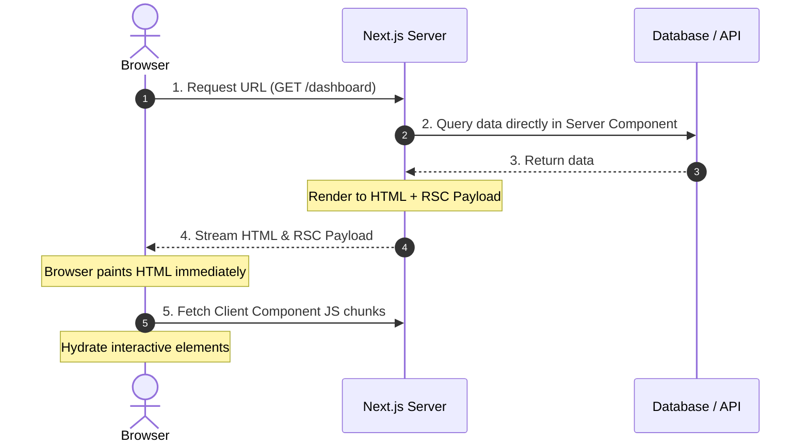
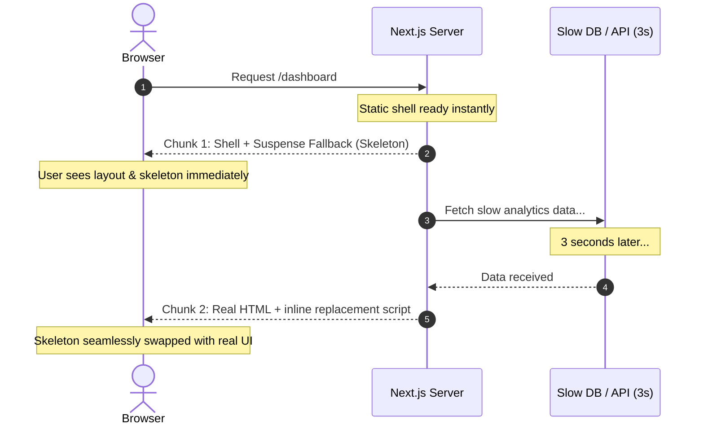

# Next.js App Router Learning Project

A hands-on Next.js project exploring the modern **App Router** architecture, nested routes, dynamic segments, and the core rendering lifecycle.

---

## 🛠 Tech Stack

- **Framework:** Next.js 16 (App Router)
- **Library:** React 19 / React DOM 19
- **Styling:** Tailwind CSS v4 (CSS-first `@theme` configuration & Turbopack)
- **Language:** TypeScript 5

---

## 🚀 Getting Started

First, install dependencies (if not already installed):

```bash
npm install
```

Run the development server:

```bash
npm run dev
```

Open [http://localhost:3000](http://localhost:3000) in your browser to see the result.

Other useful commands:
```bash
npm run build   # Build production bundle
npm run start   # Run production server
npm run lint    # Check code with ESLint
```

---

## 📂 Project Structure & Routes

```text
src/
└── app/
    ├── layout.tsx                # Global Root Layout (Geist fonts, theme shell)
    ├── globals.css               # Tailwind CSS v4 theme variables
    ├── page.tsx                  # Home entry page (/)
    │
    ├── dashboard/                # Nested Route Section (/dashboard)
    │   ├── layout.tsx            # Shared sidebar & navigation layout
    │   ├── page.tsx              # Dashboard Overview (/dashboard)
    │   ├── analytics/
    │   │   └── page.tsx          # Analytics subpage (/dashboard/analytics)
    │   └── settings/
    │       └── page.tsx          # Settings subpage (/dashboard/settings)
    │
    ├── blog/                     # Dynamic Route Section (/blog)
    │   ├── page.tsx              # Blog List Page (/blog)
    │   └── [slug]/
    │       └── page.tsx          # Dynamic Post Page (/blog/[slug])
    │
    └── navigation/               # Navigation & Architecture Lab (/navigation)
        ├── layout.tsx            # Top nav bar & lab shell
        ├── page.tsx              # Overview of the 3 performance pillars
        ├── ssr/                  # 1. Server Rendering & RSC Interop
        │   ├── page.tsx          # Side-by-side RSC + Client Component demo
        │   └── _components/      # ServerCard (RSC) & InteractiveClientCounter
        ├── prefetching/          # 2. Prefetching Mechanics Lab
        │   ├── page.tsx          # auto vs prefetch={true} vs prefetch={false}
        │   ├── _components/      # router.prefetch() programmatic controller
        │   ├── fast-target/      # Instant prefetch target
        │   └── dynamic-target/   # Dynamic on-click target
        └── streaming/            # 3. Streaming Lab
            ├── page.tsx          # Component-level <Suspense> streaming
            ├── _components/      # SlowServerCard, VerySlowServerCard, StreamedClientCard
            └── page-level/       # Page-level streaming
                ├── loading.tsx   # Automatic Suspense skeleton boundary
                └── page.tsx      # Async page simulation
```

---

## 🧠 Core Next.js Concepts & Architecture

### 1. Server Rendering (RSC & SSR)

#### What it is
In traditional React Single-Page Applications (SPAs), the server only sends an empty `<div id="root"></div>` and a massive JavaScript bundle. Next.js App Router uses **React Server Components (RSC)** by default:

* **Server-Only Execution:** Components run strictly on the server. They can directly query databases, read the file system, or use secret API keys without exposing them to the browser.
* **Zero Client JS Impact:** Server Component code and dependencies are not bundled into the client download, drastically reducing bundle size.
* **Dual Output:** For initial visits, the server produces:
  1. **HTML:** Immediately painted by the browser (fast First Contentful Paint).
  2. **RSC Payload:** A compact, serialized stream of the React element tree, props, and client boundary slots used for client-side reconciliation.
* **Client Components (`'use client'`):** Still pre-render on the server into HTML, then "hydrate" in the browser to enable interactivity (`useState`, `onClick`, browser APIs).



---

### 2. Prefetching

#### What it is
Prefetching loads the code and data for a route **before** the user clicks on it, enabling near-instant navigation without loading spinners.

#### How it works under the hood
1. **Viewport Detection:** Next.js uses an `IntersectionObserver` on `<Link>` components. As soon as a link enters the visible viewport, it is scheduled for prefetching.
2. **Prioritization Scheduler:**
   - **High Priority:** Links in the current viewport or hovered/touched by the user.
   - **Discarded:** Links that scroll off-screen before starting to conserve network bandwidth.
3. **What is Prefetched:**
   - **Static Routes:** Full RSC payload and client JavaScript chunks.
   - **Dynamic Routes:** The shared layout and static shell up to the nearest `loading.tsx` / `<Suspense>` boundary.
4. **Client-Side Router Cache:** Prefetched RSC payloads are kept in an in-memory browser cache. When the user clicks the link, the page is rendered immediately from memory.

---

### few intresting things i found in the prefetching


# Next.js Prerender Error: Dynamic Timestamps & `connection()`

## Why It Works in Dev Mode (`next dev`)

In development mode, Next.js renders every page on-demand whenever you visit or refresh it in your browser—it **never** tries to pre-build static HTML files ahead of time. Because every visit is already a live HTTP request, `new Date()` works without any issues.

The error only appears during `next build` because that is when Next.js attempts to pre-render pages ahead of time for production.

---

## Comparing the 3 Fixes

When **Partial Prerendering / Cache Components** (`cacheComponents: true`) is enabled, **Fixes #2 and #3 work together** as a pair:

| Fix | What It Does | When to Use It |
| :--- | :--- | :--- |
| **1. Disable Partial Prerendering** (`cacheComponents: false` in `next.config.ts`) | Reverts Next.js to its traditional behavior where `new Date()` or `export const dynamic = 'force-dynamic'` makes the entire route dynamic without strict build-time checks. | Use this if you don't want to manage `<Suspense>` boundaries across your app and just want classic Next.js behavior. |
| **2. Add `await connection()`** | Explicitly tells Next.js: *"Stop pre-building here and wait for an actual HTTP request before running the code below."* | Use this whenever a Server Component needs fresh request-time data (like `new Date()` or `Math.random()`) without reading `cookies()` or `headers()`. |
| **3. Wrap in `<Suspense>`** | Defines a fallback UI (like a loading skeleton) for Next.js to bake into the static shell while it waits for the `await connection()` component to finish on the server. | **Required alongside Fix #2** if `cacheComponents: true` is active. Without `<Suspense>`, Next.js still throws an error asking what to render in the static shell. |

---

## Combining Fixes #2 and #3 (Recommended for PPR)

If you keep `cacheComponents: true` enabled, combine **`await connection()`** and **`<Suspense>`** so Next.js can statically prerender and prefetch the outer shell while streaming the dynamic timestamp at request time:

```tsx
import { Suspense } from 'react'
import { connection } from 'next/server'

// Fix #2: Dynamic component that waits for a live HTTP request
async function DynamicTimestamp() {
  await connection()
  const serverTimestamp = new Date().toISOString()
  
  return <p>Fresh Server Timestamp: {serverTimestamp}</p>
}

// Main Page: Renders a static shell immediately
export default function FastTargetPage() {
  return (
    <div className="p-8 rounded-2xl border border-emerald-200 dark:border-emerald-800 bg-white dark:bg-zinc-900 space-y-6 max-w-2xl">
      <h1>Fast Target Page</h1>
      
      {/* Fix #3: Suspense tells Next.js what to put in the static HTML shell */}
      <Suspense fallback={<p>Loading timestamp...</p>}>
        <DynamicTimestamp />
      </Suspense>
    </div>
  )
}
```

With this setup, Next.js can statically prerender and prefetch the outer card (`<div>` and `<h1>`) instantly, while streaming the fresh timestamp the moment the user navigates to the page.

### make it more intrsting how it works keep a time out funtion in the <DynamicTimestamp> :- this gives us the clear partial rendering scenbario 

meaning the bare/raw html will render as soon as we visit the page . but the dynamic part will be rendered bit later. 

==> and still it will ot work why ?

reason we are keeping the await connection() on the root page but NEXT js needs atleast one stati page dusing te prod build for each route

so we are keeping the await connection() at root level NEXT will spit the error. unless we have a loading page fix 

is simple extract that dynamic function from the root jsx. and keep the place holder with suspens place holder.

like below

```tsx
import { Suspense } from "react";
import Link from "next/link";
import { connection } from "next/server";

// 1. Isolate the dynamic connection() + timestamp inside its own component
async function ServerTimestamp() {
  await connection();

    // Add a 2-second (2000ms) delay
  await new Promise((resolve) => setTimeout(resolve, 9000));  // this makes the concept even more clear add some dealy for the dynamic function.
  const serverTimestamp = new Date().toISOString();

  return <p>Fresh Server Timestamp: {serverTimestamp}</p>;
}

// 2. Keep the main page static so Next.js can prerender and prefetch the shell
export default function FastTargetPage() {
  return (
    <div className="p-8 rounded-2xl border border-emerald-200 dark:border-emerald-800 bg-white dark:bg-zinc-900 space-y-6 max-w-2xl mx-auto">
      <div className="flex items-center justify-between">
        <span className="px-2.5 py-1 text-xs font-bold rounded-md bg-emerald-600 text-white uppercase tracking-wider">
          Prefetch Destination
        </span>
        <span className="text-xs text-zinc-500 font-mono">Rendered Instantaneously</span>
      </div>

      <div className="space-y-2">
        <h2 className="text-2xl font-bold">⚡ Instant Navigation Target</h2>
        <p className="text-zinc-600 dark:text-zinc-400 text-sm leading-relaxed">
          If you navigated here after the link was prefetched, the RSC payload was pulled directly from your browser&apos;s in-memory Router Cache. Notice how there was no white screen, no browser reload, and the layout stayed perfectly intact!
        </p>
      </div>

      <div className="p-4 rounded-xl bg-zinc-50 dark:bg-zinc-800/50 border border-zinc-200 dark:border-zinc-700 text-xs font-mono space-y-1 text-zinc-600 dark:text-zinc-300">
        <p>Route: /navigation/prefetching/fast-target</p>
        <p>Rendering Type: Static / Instant Prefetched Shell</p>
        {/* 3. Wrap the dynamic component in Suspense */}
        <Suspense fallback={<p>Fresh Server Timestamp: Loading...</p>}>
          <ServerTimestamp />
        </Suspense>
      </div>

      <div>
        <Link
          href="/navigation/prefetching"
          className="text-sm font-semibold text-emerald-600 dark:text-emerald-400 hover:underline"
        >
          &larr; Back to Prefetching Lab
        </Link>
      </div>
    </div>
  );
}


```


### 3. Streaming

#### What it is
Traditional SSR is "all-or-nothing": if a single database query takes 3 seconds, the server holds the entire response, and the user stares at a blank screen for 3 seconds.

**Streaming** solves this using HTTP **Chunked Transfer Encoding** (`Transfer-Encoding: chunked`). The server sends parts of the HTML as soon as they are ready, while long-running queries resolve in parallel.



#### How to use it
- **Page-Level:** Add a `loading.tsx` file alongside `page.tsx`. Next.js automatically wraps the page in a `<Suspense>` boundary.
- **Component-Level:** Wrap individual slow async components in React's `<Suspense>`:
  ```tsx
  import { Suspense } from "react";

  export default function Page() {
    return (
      <main>
        <h1>Fast Header</h1>
        <Suspense fallback={<p>Loading slow metrics...</p>}>
          <SlowAnalyticsComponent />
        </Suspense>
      </main>
    );
  }
  ```

---

### 4. Client-Side Transitions (Soft Navigation)

#### What it is
When navigating between pages via `<Link href="...">` or `router.push()`, Next.js performs a **soft navigation** instead of a browser full-page reload:

| Feature | Hard Navigation (Traditional Web) | Soft Navigation (Next.js App Router) |
| :--- | :--- | :--- |
| **Trigger** | Plain `<a href="...">` or URL bar entry | Next.js `<Link href="...">` |
| **Page Refresh** | Full document teardown & rebuild | **No reload**; orchestrated by React in JS |
| **Shared Layouts** | Destroyed and re-rendered | **Preserved** (sidebar state, inputs, scroll remain) |
| **Network Cost** | Full HTML document + all CSS/JS | Only the **RSC Payload** for the changed child leaf |

#### How it works under the hood
1. **Prevent Default:** The `<Link>` component intercepts the native click event (`event.preventDefault()`).
2. **Segment Diffing:** Next.js compares the current route tree and destination route tree:
   ```text
   Current:     [RootLayout] -> [DashboardLayout] -> [DashboardPage]
   Destination: [RootLayout] -> [DashboardLayout] -> [AnalyticsPage]
                                                  ^^^^^^^^^^^^^^^
                                         (Only this leaf component updates)
   ```
3. **Preserving Shared State:** The parent layout components (`RootLayout` and `DashboardLayout`) never unmount. Sidebar scroll positions, local component state, and form inputs are preserved.
4. **React `startTransition`:** Next.js wraps the navigation inside React's concurrent `startTransition` API, keeping the existing page fully interactive while the incoming route prepares.
5. **History & URL Sync:** The URL updates via the HTML5 History API (`window.history.pushState`), maintaining native browser back/forward button support.

---

## 💡 Summary: The Complete Navigation Lifecycle

1. **Initial Visit:** Server executes Server Components, **Streaming** the static shell immediately so users see layout and skeletons without delay.
2. **Idle Time:** Links in viewport are automatically **Prefetched** into the browser's in-memory Router Cache.
3. **User Clicks:** Next.js performs a **Client-Side Transition**, diffing the route tree, preserving parent layouts and state, and rendering the new page instantly from the cache.
